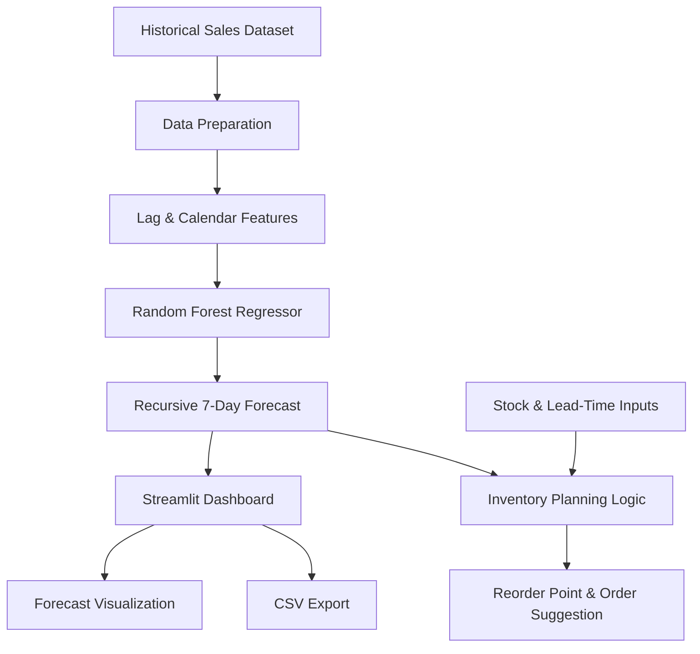
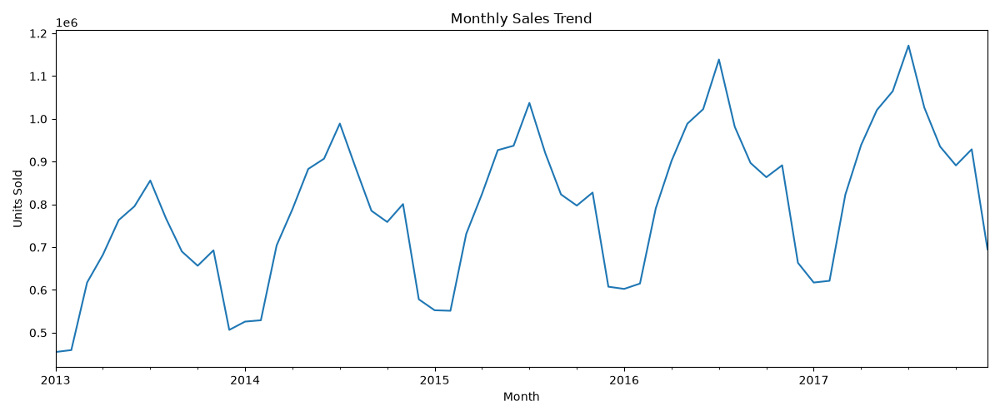

# 📦 AI Inventory & Sales Forecasting System

A machine learning project that forecasts daily product demand and supports inventory replenishment decisions using historical sales data. Built with Python, Pandas, Scikit-learn, and Streamlit.

The application combines a Random Forest regression model, time-based feature engineering, recursive 7-day forecasting, and inventory planning calculations in an interactive web dashboard.

**🔗 Live Demo:** [Open the deployed application](https://aiinventoryforcasting-qmvk6y54gdbekgafh3agmq.streamlit.app/)  
**💻 Source Code:** [GitHub Repository](https://github.com/Patel-Shiv-P/AI_Inventory_forcasting)

> **Important:** This project uses historical sales data from 2013–2017. Its forecasts demonstrate the methodology and are not predictions of current market demand.

---

## 📊 Model Performance

The Random Forest model was compared against a seasonal-naive baseline that predicts demand using sales from seven days earlier.

### Seven-day backtest results

| Metric | Seasonal Baseline | Random Forest |
|---|---:|---:|
| Average MAE | 10.475 | 8.537 |
| Average RMSE | 13.396 | 10.885 |
| Sampled series with lower MAE | — | 10/10 |
| Mean per-series MAE improvement | — | 18.62% |

**Key finding:** The Random Forest achieved lower MAE than the baseline on all 10 sampled store-item series in this backtest.

MAE and RMSE are measured in sales units. Lower values indicate smaller prediction errors.

**Evaluation scope:** These results come from a rolling-origin, recursive seven-day backtest on a sample of 10 store-item series. They do not establish performance across all 500 series or guarantee future accuracy.

### Understanding the metrics

- **MAE (Mean Absolute Error):** Measures the average absolute difference between predicted and actual sales.
- **RMSE (Root Mean Squared Error):** Penalizes larger forecasting errors more heavily.
- **MAE improvement:** Measures the relative reduction in MAE compared with the baseline.

MAE improvement is calculated as:

`((Baseline MAE - Model MAE) / Baseline MAE) × 100`

---

## ✨ Features

- 📈 **Demand Forecasting:** Generate recursive forecasts for the next seven days.
- 🤖 **Machine Learning:** Train a Random Forest regression model using lag and calendar features.
- 🏬 **Store and Product Selection:** Explore forecasts for individual store-item combinations.
- 📊 **Interactive Dashboard:** Visualize historical sales and predicted demand.
- 📦 **Inventory Planning:** Calculate inventory position, reorder point, and suggested order quantity.
- 📥 **CSV Export:** Download forecast results for further analysis.
- 🧪 **Model Evaluation:** Run chronological evaluations and compare the model against a seasonal baseline.
- 🔍 **Data Preparation:** Prepare historical sales data for analysis and forecasting.

---

## 🏗️ System Architecture

The project follows this workflow:



### Workflow explanation

1. **Data preparation:** Load and prepare historical daily sales records.
2. **Feature engineering:** Extract lagged sales and calendar features.
3. **Model training:** Fit a Random Forest regression model.
4. **Forecast generation:** Predict the next seven days recursively, using earlier predictions to construct later lag features.
5. **Inventory calculations:** Combine forecast demand with current stock, incoming stock, committed stock, lead time, and safety stock.
6. **Visualization and export:** Display the forecast in Streamlit and provide downloadable results.

---

## 🧠 Machine Learning Approach

### Algorithm

The project uses `RandomForestRegressor` from Scikit-learn.

Random Forest combines predictions from multiple decision trees to model relationships between historical sales patterns, calendar variables, and future demand.

### Input features

| Feature | Description |
|---|---|
| Sales lag 7 | Sales recorded seven days earlier |
| Sales lag 14 | Sales recorded fourteen days earlier |
| Sales lag 28 | Sales recorded twenty-eight days earlier |
| Day of week | Day-of-week calendar feature |
| Month | Calendar month |
| Day of year | Position within the calendar year |

### Forecasting strategy

The application generates a seven-day forecast recursively:

1. Predict sales for the next day.
2. Use that prediction when constructing lag features for subsequent forecast dates where applicable.
3. Repeat until the seven-day horizon is complete.

This approach makes the forecasting horizon explicit, but prediction errors can accumulate across forecast days.

### Baseline comparison

The seasonal-naive baseline predicts sales using the value from seven days earlier. Comparing the Random Forest with this simple reference helps establish whether the more complex model adds predictive value.

The evaluation scripts use chronological data splits rather than randomly mixing earlier and later dates.

---

## 📉 Evaluation and Visualizations

The repository includes model evaluation and backtesting scripts, together with a project figure.



*Figure 1: Project evaluation figure. Refer to the associated evaluation script and results for the metric definitions and evaluation scope.*

### Reproduce the evaluation

Run the following commands from the project root after installing the dependencies.

**One-day-ahead evaluation across store-item series**

```bash
python evaluate_all_product.py
```

**Recursive seven-day backtest on the sampled series**

```bash
python backtest_7day_multi.py
```

**Evaluate a larger sample, if supported by the current script version**

```bash
python backtest_7day_multi.py --sample-size 20 --trees 50
```

The seven-day backtest uses rolling forecast blocks. Within each block, the model uses its own predictions to construct later lag features.

Results can vary with the selected series, evaluation period, model configuration, and dataset version.

---

## 📦 Inventory Replenishment Logic

The project translates demand forecasts into basic inventory planning calculations.

**Inventory position**

`Inventory Position = Current Stock + Incoming Stock − Committed Stock`

**Reorder point**

`Reorder Point = Forecast Demand During Lead Time + Safety Stock`

**Suggested order quantity**

The application estimates the additional stock required to reach a target inventory level covering lead-time demand, the review period, and safety stock.

These calculations are intended as decision-support examples, not a complete production inventory optimization system.

---

## 🗂️ Project Structure

```text
AI_Inventory_forcasting/
│
├── app.py
├── data_prepairation.py
├── inspeat_data.py
├── analyze_model_results.py
├── evaluate_model.py
├── evaluate_all_product.py
├── backtest_7day.py
├── backtest_7day_multi.py
├── forcast_next_7_days.py
├── inventory_recommedation.py
├── requirements.txt
├── Figure_1.png
│
└── data/
    ├── clean_sales.csv
    ├── model_evaluation_results.csv
    └── Backtest result CSV files
```

### Main files

| File | Purpose |
|---|---|
| `app.py` | Main Streamlit application and interactive forecasting dashboard |
| `data_prepairation.py` | Data preparation workflow |
| `inspeat_data.py` | Data inspection and exploration |
| `evaluate_model.py` | Model evaluation |
| `evaluate_all_product.py` | One-day-ahead evaluation across store-item series |
| `backtest_7day.py` | Seven-day backtesting workflow |
| `backtest_7day_multi.py` | Multi-series seven-day backtest |
| `forcast_next_7_days.py` | Seven-day forecast script |
| `inventory_recommedation.py` | Inventory recommendation calculations |
| `analyze_model_results.py` | Analysis of model evaluation results |
| `requirements.txt` | Python dependencies |

---

## 🛠️ Technology Stack

- **Language:** Python
- **Data processing:** Pandas, NumPy
- **Machine learning:** Scikit-learn
- **Dashboard:** Streamlit
- **Visualization:** Matplotlib
- **Version control:** Git and GitHub
- **Deployment:** Streamlit Community Cloud

---

## 🚀 Installation and Setup

### Prerequisites

- Python 3.10 or newer recommended
- pip
- Git
- A local copy of this repository

### 1. Clone the repository

```bash
git clone https://github.com/Patel-Shiv-P/AI_Inventory_forcasting.git
cd AI_Inventory_forcasting
```

### 2. Create a virtual environment

On Windows PowerShell:

```powershell
py -m venv .venv
.\.venv\Scripts\Activate.ps1
```

If PowerShell blocks environment activation, run:

```powershell
Set-ExecutionPolicy -Scope Process -ExecutionPolicy Bypass
.\.venv\Scripts\Activate.ps1
```

### 3. Install dependencies

```bash
python -m pip install --upgrade pip
pip install -r requirements.txt
```

### 4. Verify the dataset

Confirm that this file exists:

```text
data/clean_sales.csv
```

The application expects a prepared sales dataset containing the required date, store, item, and sales columns.

### 5. Launch the dashboard

```bash
streamlit run app.py
```

Open the local URL displayed in the terminal, usually:

`http://localhost:8501`

---

## 📚 Dataset

The project uses the Store Item Demand Forecasting dataset, containing daily sales records for multiple stores and products.

- **Historical period:** January 2013 – December 2017
- **Stores:** 10
- **Products:** 50
- **Observations:** Approximately 913,000 daily sales records in the original dataset
- **Data preparation output:** `data/clean_sales.csv`

Dataset source: [Kaggle — Store Item Demand Forecasting Challenge](https://www.kaggle.com/competitions/demand-forecasting-kernels-only)

The dataset is historical and is suitable for demonstrating forecasting methods and retrospective evaluation. It does not represent current retail demand.

---

## ⚠️ Limitations

1. **Historical data:** The dataset ends in 2017. Predictions based on it cannot be interpreted as current demand forecasts.
2. **Limited backtest sample:** The reported seven-day results cover 10 sampled store-item series, not all 500 possible series.
3. **Forecast error accumulation:** Recursive forecasts can become less accurate at longer horizons because predictions feed into subsequent predictions.
4. **Model coverage:** Performance may differ across products with intermittent, seasonal, or rapidly changing demand.
5. **Safety stock:** Safety stock is user-entered and is not statistically optimized by the current application.
6. **Simplified inventory rules:** The calculation does not fully model supplier variability, pack sizes, minimum order quantities, budgets, perishability, or stockout-censored demand.
7. **No production integration:** The project is a portfolio demonstration, not a validated connection to live sales, warehouse, or supplier systems.
8. **No guaranteed business outcomes:** Forecast accuracy alone does not demonstrate reduced stockouts, lower costs, or increased profitability.

### Future improvements

- Expand multi-series and rolling-origin backtesting.
- Compare additional forecasting algorithms.
- Evaluate prediction intervals and forecast uncertainty.
- Optimize safety stock using demand and lead-time variability.
- Add supplier constraints and order quantity limits.
- Incorporate more recent sales and inventory data.
- Monitor model performance as new observations become available.

---

## 🎯 Project Objective

This project demonstrates an end-to-end machine learning workflow: preparing data, engineering forecasting features, training a regression model, evaluating predictions against a baseline, building an interactive application, and translating demand estimates into inventory planning calculations.

It is intended for learning, experimentation, and portfolio demonstration.

---

## 👨‍💻 Author

**Shiv Patel**

- GitHub: [@Patel-Shiv-P](https://github.com/Patel-Shiv-P)
- Project: [AI Inventory Forecasting System](https://github.com/Patel-Shiv-P/AI_Inventory_forcasting)

If you find this project useful, consider starring the repository.
